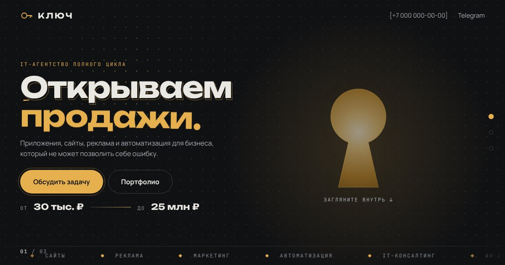
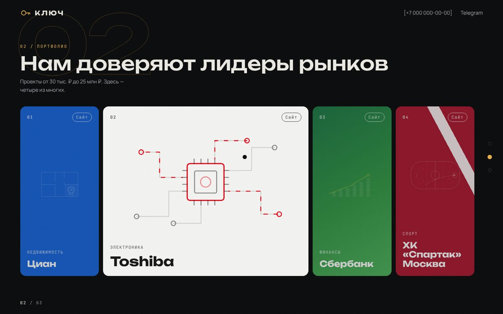
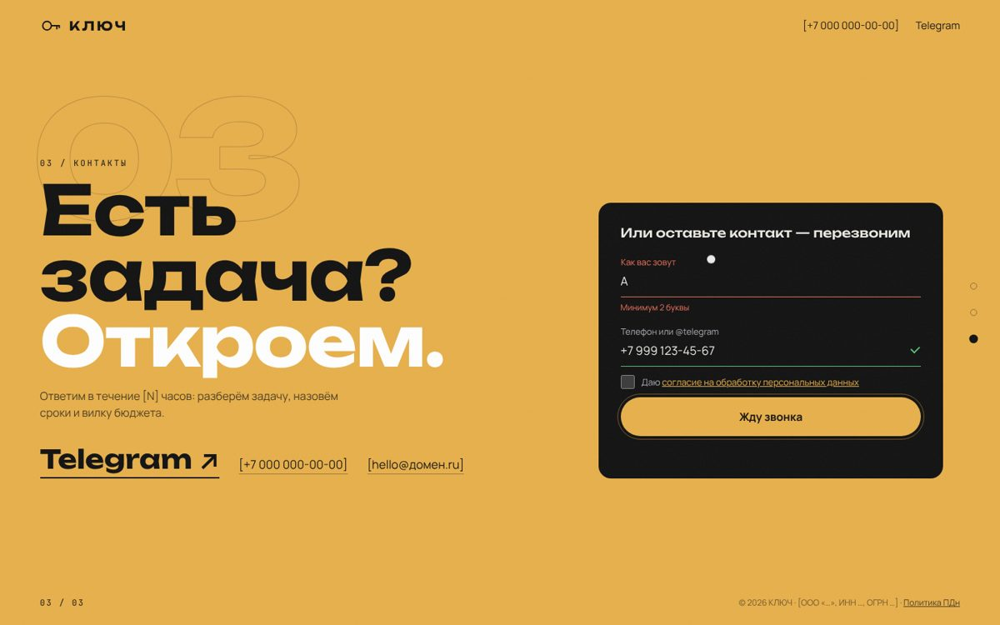

# КЛЮЧ — сайт IT-агентства полного цикла

**▶ Живая версия: https://soulinside369-blip.github.io/klyuch-site/**
(трейлер показывается один раз за визит; посмотреть снова — добавьте `?intro` к адресу)



---

## 001 · Идея

Сайт агентства, которое закрывает IT-задачи бизнеса «под ключ»: приложения, сайты, реклама, маркетинг, автоматизация.
Название подсказало концепцию — **замочная скважина**. Посетитель смотрит трейлер, видит скважину со светом за ней
и буквально входит сквозь неё в портфолио. Никакого перегруза: три экрана, листаются как презентация.

| Экран | Задача | Приём |
|---|---|---|
| Трейлер ~6,5 с | зацепить с первой секунды | кинетическая типографика по буквам, склейка направлений, растворение сквозь скважину |
| 01 · Оффер | за 5 секунд: кто мы и сколько стоит | «Открываем рост / продажи / процессы / рынки», вилка 30 тыс. – 25 млн ₽ |
| 02 · Портфолио | показать уровень | вход сквозь скважину (CSS mask), панели в фирменных цветах клиентов |
| 03 · Контакты | заявка без трения | шторка, крупный Telegram, форма из 2 полей |



## 002 · Типографика

| Шрифт | Роль |
|---|---|
| **Unbounded** 500/700 | заголовки, трейлер, названия клиентов |
| **Manrope** 400/600/700 | основной текст, кнопки |
| **JetBrains Mono** 400 | подписи, номера разделов, бегущая строка |

Все три — с кириллицей, подключены локально (`@fontsource`), без запросов к Google.

## 003 · Цвета

| Токен | HEX | Где |
|---|---|---|
| `--bg` | `#0B0C0E` | фон |
| `--text` | `#ECEAE4` | текст |
| `--accent` | `#E8B04B` | латунь ключа: акценты, кнопки, экран контактов |
| `--dim` / `--faint` | `#A9ADB3` / `#8A8F96` | второстепенный текст |

Панели портфолио берут цвета клиентов из `src/data/site.ts → cases[].theme`.

## 004 · Компоненты и состояния

- **Кнопка** — капсула с рамкой, которая раскрывается при наведении; «магнитная» к курсору.
- **Поле ввода** — подпись поднимается над линией; состояния: обычное · фокус · ошибка (красная линия + подсказка) · успех (зелёная галочка).
- **Панель кейса** — свёрнута / раскрыта; иллюстрация отрасли оживает при раскрытии.
- **Навигация** — точки справа, счётчик `01 / 03`; колесо, стрелки, свайп = ровно один слайд.



## 005 · Техника

- [Astro 5](https://astro.build): статический HTML, без JS-фреймворков; ~250 строк своего JS.
- Если слайд не помещается в экран — сайт сам переходит на обычную прокрутку, ничего не обрезается.
- Уважает «уменьшить движение»: анимации отключаются, трейлер не показывается.
- SEO: meta, Open Graph-превью, Schema.org, sitemap.xml, robots.txt.

```bash
npm install
npm run dev      # http://localhost:4321
npm run build    # готовый сайт в dist/
```

Весь контент — в одном файле: `src/data/site.ts`.

**Публикация.** GitHub Pages — автоматически при пуше в `main`. На Pages форма заявки не работает (там нет PHP).
Для боевого хостинга с PHP: собрать с `SITE_URL=https://домен.ru`, залить `dist/`, на сервере скопировать
`api/config.example.php` → `api/config.php` и вписать токен Telegram-бота.

---
Названия клиентов и фирменные цвета в портфолио принадлежат их владельцам; логотипы не используются.
